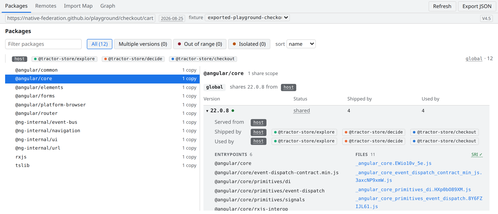
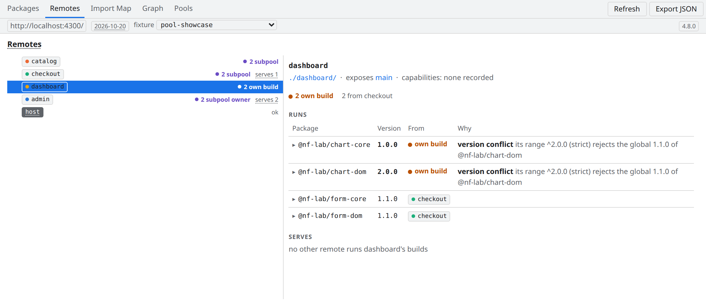
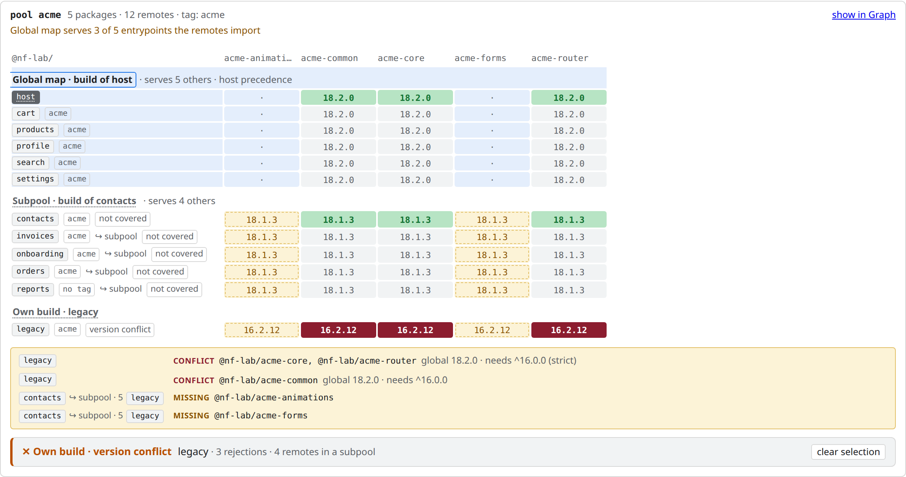

# Native Federation DevTools

**See what your micro frontends actually negotiated.**

A read-only Chrome and Firefox DevTools panel for [Native Federation](https://native-federation.com) applications running the **v4 Orchestrator**.

<picture>
  <source media="(prefers-color-scheme: dark)" srcset="docs/assets/readme/hero-graph-dark.png">
  
</picture>

> *Which version of `@angular/core` won? Who provided it? Why did that remote
> end up with its own copy?*

The negotiation happens once at startup — then it disappears into the import
map. Native Federation DevTools reads it back out of the running page and
explains it: every shared package, every remote, every chunk. Evidence, not
guesses.

## What you get

- 📦 **Packages** — the negotiation, per package and share scope: every
  version, the resolver's verdict for each remote, and a deep dive into who
  ships it, its entrypoints and its files. Out-of-range remotes, own copies
  and subpools are called out with the reason, not averaged away.
- 🛰️ **Remotes** — each participant from its own point of view: where every
  package it declares runs from — its own build, another remote's, a subpool —
  and why, plus which other remotes run its builds.
- 🕸️ **Graph** — remotes, dependency copies, and build files as one
  traceable picture. Hover to trace, tick remotes to include or exclude
  them, select dependencies to see only their build files, group the
  dependency column by provider, share scope, pool, or build.
- 🗺️ **Import Map** — the effective map, row by row, each entry attributed
  to its package, its provider, and the chunk bundle that serves it.
- 🧩 **Pools** — one matrix per explicit pool tag: which remotes run on the
  global map, in a subpool, or on their own build, and why — every range
  rejection and every entrypoint the global map lacks. Appears only when the
  capture carries pool tags.
- 📤 **Export JSON** — freeze the entire snapshot to a file. Doubles as a
  reproducible bug report.
- 🔒 **Read-only, zero permissions** — no host permissions, no content
  scripts. The panel inspects; it never mutates the page. Enforced by tests,
  not by convention.

In progress: **Diagnostics** (registry↔map lint) and global search.

## Hover to trace

One hover answers *"who shares this — and which files does it load?"*

<picture>
  <source media="(prefers-color-scheme: dark)" srcset="docs/assets/readme/hover-trace-dark.gif">
  
</picture>

Dashed nodes are isolated copies, dotted edges are served by another remote —
the sharing story is visible at a glance.

## Every negotiation, explained

<picture>
  <source media="(prefers-color-scheme: dark)" srcset="docs/assets/readme/packages-dark.png">
  
</picture>

Four remotes ship `@angular/core` 22.0.8: the host's build is shared, the
other three resolve to it, and every entrypoint and file is accounted for, SRI
included. The compatibility matrix shows which declared range accepts which
version, and a remote whose range rejects the shared version is flagged even
when it isn't strict — the orchestrator stores a plain skip for it.

## Every remote, from its own point of view

<picture>
  <source media="(prefers-color-scheme: dark)" srcset="docs/assets/readme/remotes-dark.png">
  
</picture>

One row per package: the version this remote runs, whose build it comes from,
and — only when it is off the norm — a short reason, explained on hover. Open a
row for its declared range, pool, entrypoints, and the remotes it serves. A
warning flags flat externals or flat chunking when the capture proves them; the
list marks only what is out of range or resolves nowhere.

## Why a remote left the pool

<picture>
  <source media="(prefers-color-scheme: dark)" srcset="docs/assets/readme/pools-dark.png">
  
</picture>

The host's build serves the global map, but it ships neither `acme-animations`
nor `acme-forms`, so five remotes share a subpool on contacts' build instead.
`legacy` runs the whole family from its own build: its ranges reject the global
versions. Select a pool — click its label or any of its remotes — and the
warning lists what keeps remotes off it, one line per problem, a subpool shown
once as its owner; hover a remote's cause for all its reasons. Select a subpool
or own build to see which remotes would fit that build instead. Reasons are
recomputed from the stored records with the orchestrator's own rules and
checked against the cause it stored.

## Requirements

> **Requires the v4 Orchestrator.** The panel reads the registry that
> [`@softarc/native-federation-orchestrator`](https://github.com/native-federation/orchestrator)
> keeps in the page (`window.__NATIVE_FEDERATION__`). Applications on the
> classic **v3 runtime** (`@softarc/native-federation-runtime`) do not expose
> this registry and are **not supported** — on such pages the panel shows
> *No Native Federation detected*.
>
> The registry is found under the default storage options, a custom
> `storageNamespace`, and `localStorage` / `sessionStorage` storage. Since
> orchestrator 4.7 the panel follows the storage descriptor the orchestrator
> publishes (`window.__NF_ORCHESTRATOR__`). On older versions it falls back to
> the default namespace in `window`, then `localStorage`, then
> `sessionStorage`. **Custom storage adapters are not supported.**

## Install

🛒 **Chrome Web Store: coming soon** — the extension will be published under
the official Native Federation presence. Until then, install it from a GitHub
release. No build toolchain needed — it takes about a minute.

### From a release

1. Download `native-federation-devtools-<version>.zip` from the
   [releases page](https://github.com/native-federation/devtools/releases)
   and unzip it into a folder of its own (the zip has no top-level folder).
   Keep that folder — Chrome loads the extension from it.
2. Open `chrome://extensions` in Chrome — type it into the address bar.
3. Turn on **Developer mode** (toggle in the top-right corner).
4. Click **Load unpacked** and select the unzipped folder.
5. Open Chrome DevTools (`F12`, or `Ctrl+Shift+I` / `⌥⌘I`) on an application
   that runs the v4 Orchestrator. The panel appears as a new
   **Native Federation** tab — if DevTools was already open, close and reopen
   it once.

Unpacked extensions do not update themselves. To upgrade, unzip the new
release into the same folder and click the ↻ reload icon on the extension's
card in `chrome://extensions`. Automatic updates come with the Web Store.

### Firefox

Firefox 140 or later. Until the add-on is signed on addons.mozilla.org,
Firefox loads it as a temporary add-on, which is removed when Firefox
restarts. Build it from source (`npm run build:extension`), then open
`about:debugging#/runtime/this-firefox` → **Load Temporary Add-on…** → select
`dist/extension-firefox/manifest.json`. Or run `npm run start:firefox`, which
starts a separate Firefox profile with the add-on loaded and DevTools open.

### From source

Contributors can build the extension themselves — see
[Development & Architecture](docs/DEVELOPMENT.md#install-development-build).

## Native Federation ecosystem

| Project | What it is |
| --- | --- |
| [native-federation.com](https://native-federation.com) | Project home — docs, guides, team, resources |
| [orchestrator](https://github.com/native-federation/orchestrator) | Runtime micro frontend orchestrator (v4) — the runtime this panel reads |
| **devtools** (this repo) | Chrome and Firefox DevTools panel for inspecting running federations |

## Documentation

- [Development & Architecture](docs/DEVELOPMENT.md) — build, run, test,
  repository layout, and the design constraints behind the tool
- [Resolution data model](docs/resolution-data-model.md) — how a captured
  snapshot becomes the model behind the views

## About

Developed and maintained by [Lutz Leonhardt](https://lutzleonhardt.de) as
part of the official Native Federation project.

Built in an agentic workflow with Claude Code and Codex as pair programmers —
architecture, review, and verification stay with the maintainer.

Licensed under [MIT](LICENSE).
